# 1D Mesh Construction and Data Flow

The files in this directory divide 1D mesh work into face generation, mesh
ownership, and shared geometry calculations. There is no central mesh factory
or input reader: the calling code creates a `Domain1D`, chooses a construction
route, and supplies the cell count or face coordinates.

## Files and responsibilities

- `uniform_fv_mesh1d.hpp` / `src/mesh/mesh1d/uniform_fv_mesh1d.cpp` implement
  `UniformFvMesh1D`. The caller supplies a `Domain1D` and cell count, or the
  start and end coordinates and cell count. The coordinate overload first
  constructs a `Domain1D`. The class computes nominal spacing as the represented
  domain length divided by the cell count and generates the face coordinates.
  Boundary faces retain the domain endpoints exactly. `dx()`, `spacing()`, and
  `nominal_spacing()` report the target spacing; actual widths come from the
  stored faces. `UniformMesh1D` and `Mesh1D` are aliases for this class.
- `grading1d.hpp` / `src/mesh/mesh1d/grading1d.cpp` implement the free functions
  `cfd::mesh::grading::make_1d_faces` and
  `cfd::mesh::grading::ratio_from_total_ratio`. For face generation, the caller
  supplies a domain, at least two cells, a `GradingType`, and a ratio. The
  function builds normalized cell-width weights, converts cumulative weights to
  faces, and returns a vector of `N + 1` coordinates. It preserves the exact
  domain endpoints and validates that faces and interior centers are
  representable. It does not construct or own a mesh. The grading enum itself
  is declared in `include/cfd/mesh/grading_type.hpp`.
  `ratio_from_total_ratio` converts the requested largest generated cell width
  divided by the smallest into the per-cell ratio for one exponent increment.
  Its meaning is independent of left-to-right direction: Forward and Backward
  have the same exponent span and therefore return the same value. Symmetric
  modes with two cells have zero exponent span and are rejected.
- `non_uniform_fv_mesh1d.hpp` /
  `src/mesh/mesh1d/non_uniform_fv_mesh1d.cpp` implement
  `NonUniformFvMesh1D`. The caller supplies a domain and explicit face vector.
  This is also the consumer for faces returned by `make_1d_faces`; the caller
  connects the generator to this constructor.
- `fv_mesh1d.hpp` / `src/mesh/mesh1d/fv_mesh1d.cpp` define the common base
  `FvMesh1D`. Its protected constructor takes ownership of a face vector,
  validates the full interval and face sequence, then derives each cell width
  and center. Derived mesh classes therefore share the same stored geometry
  and query API.

## Dependency graph

The graph shows both the header/source dependencies and the runtime path from
caller input to usable mesh geometry. `Domain1D` and `GradingType` are defined
outside this directory; downstream finite-volume and field code consumes the
geometry API.

```mermaid
flowchart LR
    caller[Caller]
    domain[Domain1D<br/>geometry/domain/domain1d.hpp]
    grading_type[GradingType<br/>mesh/grading_type.hpp]

    subgraph mesh1d[mesh/mesh1d]
        uniform_api[uniform_fv_mesh1d.hpp<br/>UniformFvMesh1D]
        uniform_impl[uniform_fv_mesh1d.cpp<br/>build uniform faces]
        graded_api[grading1d.hpp<br/>make_1d_faces]
        graded_impl[grading1d.cpp<br/>build graded faces]
        nonuniform_api[non_uniform_fv_mesh1d.hpp<br/>NonUniformFvMesh1D]
        nonuniform_impl[non_uniform_fv_mesh1d.cpp<br/>validate supplied faces]
        base_api[fv_mesh1d.hpp<br/>FvMesh1D]
        base_impl[fv_mesh1d.cpp<br/>validate and derive geometry]
    end

    faces[Face coordinate vector]
    geometry[Owned faces, widths, and centers]
    queries[Read-only geometry queries and spans]
    consumers[Finite-volume and field consumers]

    caller -->|domain + cell count| uniform_api
    domain -. used by .-> uniform_api
    uniform_api --> uniform_impl
    uniform_impl -->|generated faces| base_api

    caller -->|domain + cell count + type + ratio| graded_api
    domain -. used by .-> graded_api
    grading_type -. used by .-> graded_api
    graded_api --> graded_impl
    graded_impl --> faces
    faces -->|caller passes vector| nonuniform_api

    caller -->|domain + explicit faces| nonuniform_api
    domain -. used by .-> nonuniform_api
    nonuniform_api --> nonuniform_impl
    nonuniform_impl -->|validated faces| base_api

    uniform_api -. inherits from .-> base_api
    nonuniform_api -. inherits from .-> base_api
    base_api --> base_impl
    base_impl --> geometry
    geometry --> queries
    queries --> consumers
```



## Input flow and termination

All construction starts at the caller. A `Domain1D` supplies authoritative,
finite, increasing bounds; mesh constructors use those values as a snapshot, so
later domain changes do not change an existing mesh.

```text
Caller
  ├─ Domain1D + cell count ──> UniformFvMesh1D
  │                              └─ computes nominal spacing and faces
  ├─ Domain1D + explicit faces ─> NonUniformFvMesh1D
  └─ Domain1D + cell count + GradingType + ratio
                                 └─ grading::make_1d_faces -> face vector
                                      └─ caller passes vector to NonUniformFvMesh1D

UniformFvMesh1D / NonUniformFvMesh1D
  └─ FvMesh1D validates faces and derives widths and centers
       └─ read-only geometry queries and spans exposed to downstream code
```

For `UniformFvMesh1D`, the input terminates as an owned mesh containing its
faces, widths, and centers. For explicit nonuniform input, validation happens
first in `NonUniformFvMesh1D` (finite, strictly increasing faces whose first
and last values exactly match the domain), then shared validation and
derivation happen in `FvMesh1D`. The grading route terminates first at the
returned face vector. It reaches a mesh only if the caller passes that vector
to `NonUniformFvMesh1D`, which applies the same checks.

After construction, consumers read geometry through `FvMesh1D` methods such as
`face()`, `cell_center()`, `cell_width()`, `cell_volume()`,
`distance_to_west_face()`, and `distance_to_east_face()`, or through its
read-only spans. Face indices run west to east: face `0` is the west domain
boundary and face `num_faces() - 1` (equivalently `num_cells()`) is the east
boundary. Center-to-face distance queries check that the cell index is valid.
Volumes assume unit cross-sectional area, so their numerical values equal cell
widths. The mesh layer does not itself advance a simulation
or read field values; it ends by providing validated, immutable-through-this-API
geometry for finite-volume and field code.

The examples under `examples/test_mesh/test_mesh1d/` demonstrate these paths:
the uniform example constructs a uniform mesh, and the grading example
generates faces and passes them to `NonUniformFvMesh1D`.
